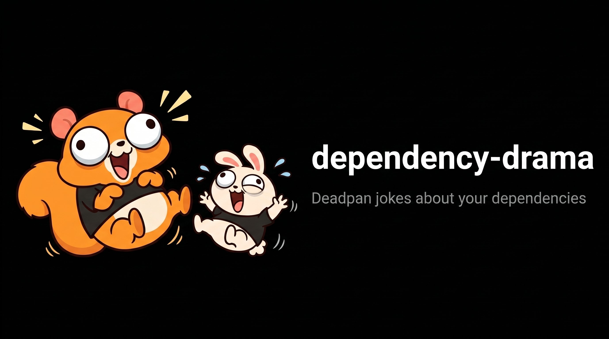

<p align="center">
  
</p>

# dependency-drama

Deadpan jokes about your dependencies. Every line is a true fact from the lockfile.

```
PREVIOUSLY ON shop-web…

  left-pad is deprecated and still here. In 2016 it left npm for a few hours and builds around the world stopped. It knows what it is worth.
  request retired in 2020 and is still installed. It was downloaded millions of times a week when it stopped. Old habits.
  express 4.22.3 is 1 major version behind. Version 5 was about ten years in the making, so nobody here feels rushed.
  webpack lives at 4.47.0. 5.112.2 sends postcards. They go unopened.
  The guest list said 9 guests. The caterer counted 461.
```

It is a toy. It is also, by accident, a readable summary of what is rotting in your `node_modules`.

## Status

Early. It reads npm's `package-lock.json` (npm 7 or newer) and pnpm's `pnpm-lock.yaml` (pnpm 9
or newer) and prints an episode.

## Install

```bash
npx dependency-drama                              # run once, nothing installed
brew install ryckakas/tap/dependency-drama        # macOS and Linux
cargo install dependency-drama --locked           # from source, Rust 1.100 or newer
curl --proto '=https' --tlsv1.2 -LsSf https://github.com/ryckakas/dependency-drama/releases/latest/download/dependency-drama-installer.sh | sh
```

On Windows:

```powershell
powershell -ExecutionPolicy Bypass -c "irm https://github.com/ryckakas/dependency-drama/releases/latest/download/dependency-drama-installer.ps1 | iex"
```

Every release also has archives for each platform, with checksums, on the
[releases page](https://github.com/ryckakas/dependency-drama/releases).

## Usage

```bash
dependency-drama              # the project in the current directory
dependency-drama path/to/app  # another project, or its lockfile
dependency-drama --markdown   # Markdown, for a pull request comment
dependency-drama --json       # JSON, for a tool that writes its own comment
dependency-drama --offline    # ask the npm registry nothing
dependency-drama --base ../before  # also tell what changed since that state
```

## GitHub Action

The action writes the episode to the job summary of every run. On a pull request that changes
the lockfile it also posts the episode as one comment, including what the pull request did,
and updates that comment on later pushes. When the pull request leaves "Previously on" as it
was, the comment folds that part away, so what the pull request did is what a reviewer sees.
What the pull request did is measured the way GitHub's own diff measures it: from the tip of the
base branch for the default checkout (GitHub's merge commit), and from the commit the pull request
branched off when a workflow checks out the pull request's head.

```yaml
on: pull_request

permissions:
  contents: read
  pull-requests: write # for the comment; without it only the job summary is written

jobs:
  drama:
    runs-on: ubuntu-latest
    steps:
      - uses: actions/checkout@v7
        with:
          persist-credentials: false # the action never uses git credentials
      - uses: ryckakas/dependency-drama@v0.1.0 # or pin the release's full commit SHA
```

A tag can be moved; a commit SHA cannot. To pin, replace `v0.1.0` with the 40-character commit
the release tag points at and keep the version in a comment, which Dependabot then updates too.

| Input | Default | |
|---|---|---|
| `path` | `.` | The directory that holds `package-lock.json` or `pnpm-lock.yaml` |
| `version` | `latest` | The release to install |
| `comment` | `true` | `false` keeps it to the job summary |
| `offline` | `false` | `true` asks the npm registry nothing |

A pull request from a fork gets a read-only token, so it gets the job summary and no comment.

### Monorepos

npm and pnpm workspaces share one lockfile at the root, and the dependencies of every workspace
member are read from it: one step, default `path`. Tonight compares each member with its own
earlier state, so a major upgrade in some members says how many of those using the package moved.
Projects with their own lockfile in separate directories get one step each, and one comment each:

```yaml
      - uses: ryckakas/dependency-drama@v0.1.0
        with:
          path: frontend
      - uses: ryckakas/dependency-drama@v0.1.0
        with:
          path: admin
```

The action reads only a few files: the lockfile, `package.json` beside it (for the project's
name), and the registry settings `.npmrc` and, for pnpm, `pnpm-workspace.yaml`. A large
repository can check out just those:

```yaml
      - uses: actions/checkout@v7
        with:
          persist-credentials: false
          sparse-checkout: |
            /package.json
            /pnpm-lock.yaml
            /pnpm-workspace.yaml
            /.npmrc
          sparse-checkout-cone-mode: false
      - uses: ryckakas/dependency-drama@v0.1.0
```

For a project in a subdirectory, list its files under that directory, and keep `package.json`:
without it, the project is named after the checkout directory, which in CI is the repository's
name.

## What it looks for

| Scene | The fact behind it |
|---|---|
| Entourage | Installed packages far outnumber the ones you asked for |
| Almost ready | A direct dependency still at version 0.x |
| Ghost | A package that is deprecated and still installed |
| Clones | Several versions of the same package |
| Feud | A peer dependency range the installed version does not satisfy |
| Time capsule | A direct dependency one or more major versions behind |
| Missing person | A direct dependency whose registry entry has not changed in three years |
| Collection plate | Packages asking for funding (`npm fund`) |
| Night visitor | Packages that run a script on install |

With `--base`, pointing at the same project before a change (a directory or its lockfile),
up to three more scenes follow under "Tonight", and one closing line names any change left
without a scene:

| Scene | The fact behind it |
|---|---|
| New arrival | A direct dependency that was not there before |
| Written out | A direct dependency that is no longer there |
| Recast | A direct dependency moved up a major version |

An episode has five scenes at most, not counting tonight's, and every kind of fact gets one scene
before any kind gets a second. The same lockfile always gives the same
episode for the same project name, which is the `name` in `package.json` (npm also keeps it in
`package-lock.json`). Only a project without one is named after its directory, and that name can
differ between a CI checkout and a local clone.

## JSON

`--json` prints the same episode as data, so another tool can lay out the comment itself:

```json
{
  "schema": 1,
  "project": "shop-web",
  "scenes": [
    {
      "kind": "time_capsule",
      "facts": { "name": "webpack", "version": "4.47.0", "latest": "5.112.2", "majors_behind": 1 },
      "text": "webpack is 1 major version behind. Nobody has told it about 5.112.2.",
      "markdown": "webpack is 1 major version behind. Nobody has told it about 5.112.2."
    }
  ]
}
```

`kind` is the scene from the table above in snake case, or `quiet` (without `facts`) when the
lockfile gave the writers nothing. `text` is the line as the terminal shows it; `markdown` is the
same line escaped, safe to paste into a comment. The values in `facts` come straight from the
lockfile and the registry and are **not** escaped. `schema` goes up when a field is removed or
changes meaning; new fields and kinds may appear without it.

`untold`, present only when it has entries, lists what the change did that had no room for a
scene, each as `kind` and `facts`. The terminal and Markdown layouts name those in one closing
line, "Also tonight: …", so no change goes unmentioned.

## npm and pnpm

Both are read into the same list of packages, so the scenes and the lines are the same. Two
differences:

- `pnpm-lock.yaml` does not record funding requests or install scripts, so a pnpm project never
  gets the collection plate or the night visitor.
- In a directory that has both lockfiles, `package-lock.json` is read. Name the other file to
  choose it: `dependency-drama pnpm-lock.yaml`.

Lockfiles from npm 6 or older and from pnpm 8 or older get a one-line message and exit code 0.

## What leaves your machine

To learn how far behind a dependency is, the tool asks `registry.npmjs.org` about each **direct**
dependency that was installed from `registry.npmjs.org`: one request per package, containing the
package name. Nothing else is sent. `--offline` sends nothing at all, and the two registry scenes
are left out.

A package from a private registry, a git URL or a local path is never looked up. How that is known
depends on the lockfile:

- **npm** records the URL every package was downloaded from, so the lockfile decides.
- **pnpm** does not record which registry a package came from. The tool reads the registry
  settings pnpm itself would use: `.npmrc` and `pnpm-workspace.yaml` beside the lockfile, your own
  `~/.npmrc`, the file `NPM_CONFIG_USERCONFIG` names, and `npm_config_*` environment variables. A
  scope pointed at another registry is never looked up, and if the default registry is not
  `registry.npmjs.org`, no unscoped name is. A registry configured somewhere else (a global
  `npmrc`, pnpm's own global config) is not seen: use `--offline` there.

## Writing lines

The jokes live in plain text files under [`src/lines`](src/lines), one line per row, with
`{placeholders}` for the facts. No Rust is needed to add one. Two rules:

- The joke is on the package or on the project, never on a person. Maintainers owe nobody anything.
- Keep it deadpan and safe to paste into a work chat.

A test fails if a line uses a placeholder its scene does not provide.
[CONTRIBUTING.md](CONTRIBUTING.md) lists the placeholders of every scene.

[`celebrities.txt`](src/lines/celebrities.txt) holds lines for packages most developers know by
name (`package | scene | line`). They replace the general lines when a scene is about that
package. They stick to public technical history that stays true whatever version is installed, and
a line is removed without argument if the package's maintainers ask.

## License

MIT
